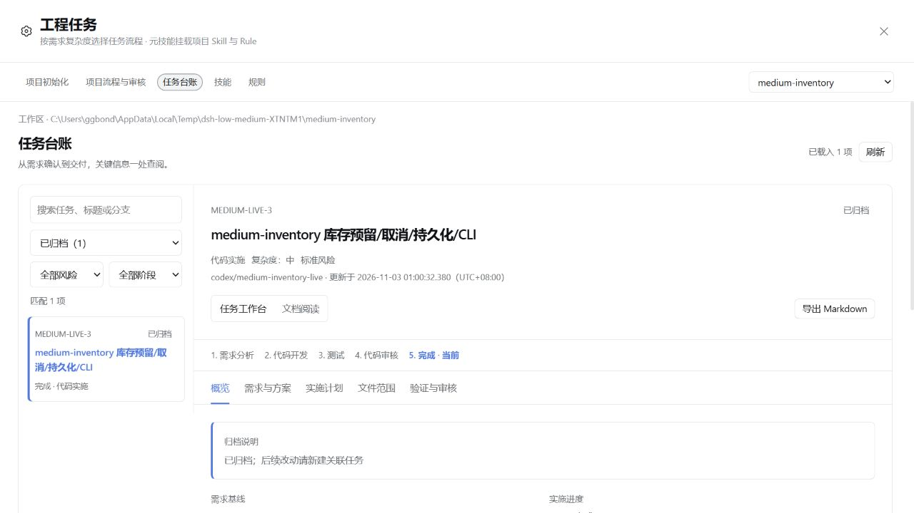

# 低、中复杂度真实流程验收

发布归属：本报告所述修改纳入 0.40.0；候选版本和哈希仍按实际测试时点记录。

日期：2026-11-03，Asia/Shanghai。承接[流程修复验证](workflow-review-recovery-fixes.md)。

本轮评测对象是通用工程插件。使用新建的 JavaScript 与 Python 隔离仓库，没有使用业务项目、生产数据库或项目专用规则。两项任务均经历需求总结、原生需求确认、实施计划、模型实现、真实测试、验收、本地 Git 提交和归档。

## 结果

| 项目 | 低复杂度 | 中复杂度 |
| --- | --- | --- |
| 任务 | LOW-LIVE-3 | MEDIUM-LIVE-3 |
| 实现 | 中文时长格式化函数及输入校验 | 库存预留、幂等、取消、原子 JSON 持久化、CLI |
| 语言与运行器 | JavaScript，Node 22.22.3 / node:test | Python 3.13.5 / 标准库 unittest |
| 需求确认 | 原生卡片确认 v1；确认前无业务文件修改 | 原生卡片确认 v1；确认前无业务文件修改 |
| 最终引擎测试 | 4 项通过 | 全量 24 项通过；服务组 15、CLI 组 8，与全量存在重叠，不能相加 |
| 独立审计 | 2 项通过：1000 个确定性输入、边界值及非法输入 | 5 项通过：幂等/重启、失败不变、真实替换失败、坏 JSON、真实 CLI 输出 |
| 实际提交 | `88982c5fbe75f8b48120e76b526603989672a7f6`，2 个文件 | `e757ca94f8a20cd7ac217be8874fb6f8698a4ed0`，4 个文件 |
| 最终状态 | 已完成并归档；工作区干净 | 已完成并归档；保留一处未提交基线测试适配，见下文 |
| 委派 | 主会话实施与审核，无子代理 | 主会话实施与审核，无子代理；CLI 依赖服务层 |

需求口径是预先明确的合成案例，不评估需求模糊时的澄清能力。此前的多轮产品清单和高复杂度独立审核测试另有报告。

## 本轮暴露与处理的问题

### 标准库 unittest 通过结果未被识别

基线程序真实输出 `Ran 1 test ... OK` 并退出 0，但已有解析器不能提取测试数量。这会把有效验证当成没有测试证据。

新增对真实 `python -m unittest` 与 `py -3.x -m unittest` 命令的识别，读取完整末尾汇总。跳过和预期失败不计为实际通过；全跳过、空套件、失败及不完整汇总不能放行。没有通过安装 pytest 来改动项目的测试体系。

纯解析边界用例和实际 Python 子进程均已验证，包括 Python 3.13 的 `NO TESTS RAN`。该修复已在中复杂度真实会话使用，三组回执分别正确记录 15、8、24 项。

### 已计划的测试先被原生终端执行，再进入引擎验证

中复杂度模型先直接调用 pwsh 运行已登记测试，产生没有引擎回执的重复执行和后台等待。环境阻塞时又尝试修改临时目录位置，仍然受限。

最终候选在任务绑定后，对与已登记验证组完全一致的原生测试命令返回明确引导：未执行命令，应使用 `dev_task verify`。普通诊断、未登记的探索命令、不同工作目录和其他会话不受此项路由影响。这是减少误用的调用路由，不宣称能够拦截所有复合 shell 命令。

测试覆盖引擎绑定、两类工具钩子、参数和引用等价、其他目录与其他任务隔离。真实 rc.5 SDK 的原生 pwsh/bash 调用验证得到 `registered_tests_routed=true`，模型 API 调用数为 0。

### 快速测试受阻时只能等待固定十分钟

新增 `verify.timeout_ms`，运行时校验为 1,000–600,000 毫秒；未指定时仍保留十分钟，兼顾较慢的构建。超时仍记录失败，不能放行；恢复重试保留本次设置，不改动测试命令或长期会话权限。30 秒执行预算传递、无效预算拒绝和环境重试参数保留均有测试。

构建时也验证了 DSH 的实际 Schema 限制：数值范围通过描述和运行时校验表达，避免使用宿主不支持的 `minimum` / `maximum`。

### 环境失败与模型输出中断

低复杂度遇到 Node 子进程 `spawn EPERM`。中复杂度遇到临时目录访问/清理失败和 CLI 子进程管道受限。仅批准确切验证命令的一次正常权限执行；两场会话的权限事件都只有初始 `workspace-write`，没有切换整场会话权限或改动 ACL。

两场会话各发生一次 `MALFORMED_RESPONSE`（模型流中的工具参数不是有效 JSON）。这是宿主报告的模型输出错误；没有在插件中伪造成功或吞掉异常。再次发送继续指令后，同一任务、同一已确认需求与有效测试回执继续使用，无需重建或重跑已有效测试。

中复杂度的 CLI 还出现过测试辅助函数少传期望值的真实失败。模型补齐明确的期望记录后重跑，失败回执保留，最新通过结果才放行。

### 工作区与实际提交不完全一致

中复杂度模型为适应受限环境，将 `tests/test_baseline.py` 的临时目录改到项目内。该文件不在交付范围，没有混进提交，但工作区留下了未提交修改。这一行为不应算作理想执行。

为避免仅凭带额外修改的工作区宣称交付有效，评测另从最终提交 `e757ca9` 导出全新副本，保留原始基线，重新执行标准全量命令：24 项全部通过。原会话及其失败/恢复证据保留，未手改已归档台账。最终提示已继续强调环境问题不得靠修改测试辅助程序解决；精确测试路由会让这类命令更早进入受控验证，但没有新增“禁止一切范围外写入”的全面文件系统隔离功能。

## 成本观测与可信度边界

| 主会话日志统计 | 低复杂度 | 中复杂度 |
| --- | ---: | ---: |
| 工具调用 | 38 | 77 |
| 非缓存输入 token | 62,994 | 66,964 |
| 缓存读取 token | 806,784 | 3,718,272 |
| 输出 token | 9,855 | 46,395 |
| 工具错误结果 | 2 | 5 |
| 首轮开始至最终轮结束 | 8.37 分钟 | 43.24 分钟 |

工具错误包含正常门禁拒绝、目录被当成文件、读取版本冲突和主动停止，不等于代码缺陷数。上述时间包含需求确认、批准等待、操作者开发插件、一次主动停止、模型异常后的等待与恢复；不能作为纯模型执行速度，也不能据此宣称相对旧版或其他产品有某个性能提升。两个标准风险案例没有子代理，不能用来判断高风险独立审核的额外成本。

本轮证明可恢复并最终正确交付，尚未证明无人干预完成。Windows 沙箱根因和模型流 JSON 错误没有在插件中被修复。SonarQube、CodeGraph 未配置，本轮不验证二者。

## 最终候选检查

| 检查 | 结果 |
| --- | --- |
| 全量回归 | 432 项：425 通过、0 失败、7 项原有宿主测试跳过；前置 P0 143 项通过 |
| 类型检查与构建 | 通过 |
| rc.5 源码契约 | 40 项 Remote、79 项严格 codec、托管激活及 peer 范围通过 |
| 真实 rc.5 SDK 预设 | 需求确认/材料、只读限制、材料变更撤销写权限、精确测试路由等通过；0 次模型 API |
| 安装包黑盒 | 冷安装、入口、客户端、资源、流程、真实 Git hook、包内 P0 通过 |
| 官方源码页面安装 | 最终 tarball 已通过官方插件 CLI 装入隔离 web profile，重启 54615 后归档台账正常读取 |
| 已安装文件比对 | 10 个关键 JS、提示词、Skill、hook 的 SHA-256 与候选一致 |
| 原有无关修改 | 两份原有文件 SHA-256 未变，没有纳入候选覆盖 |

精确最终 tarball SHA-256：`a28942ce11523585d9a5e59b609352af3ad3dd4fe420234dc9500a3f6dcf51f8`。

低复杂度会话使用前一流程修复候选；中复杂度会话额外使用 unittest 解析修复。之后发现的精确命令路由、单次超时和提示词调整，在最终候选通过单元测试、实际 SDK 与安装检查，**没有再调用模型重跑这两个已归档任务**。因此不把本轮 43 分钟说成最终候选修复后的耗时。

本次仅为本地候选，包内版本仍为 0.39.0；没有提交或发布插件。两个示例仓库中的本地业务提交是测试流程的交付证据，不是插件发布提交。

完整会话解码统计、测试回执、独立审计、干净提交验证、构建、SDK、安装与哈希证据保存在被忽略的 `docs/assessment-20261102/source-host/low-medium-*` 等文件。隔离 profile 含本机凭据，不能提交或复制到发布包。

