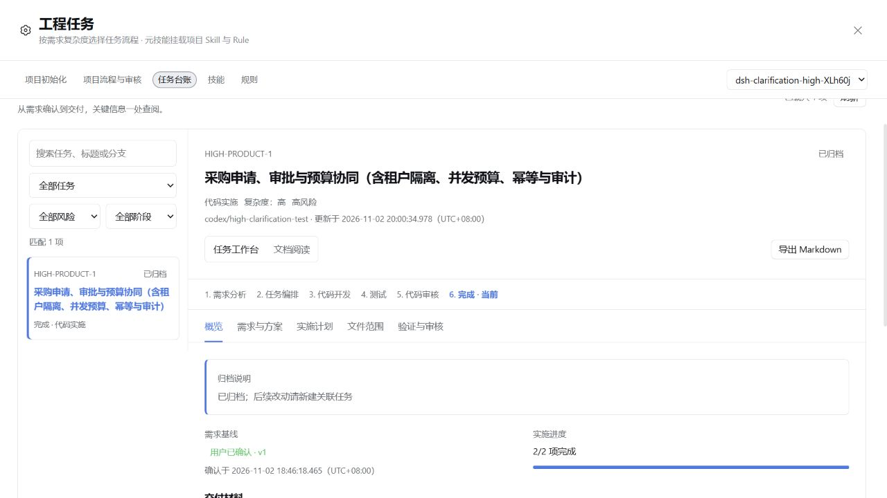

# rc.5 高复杂度需求与产品确认 Skill 实测

日期：2026-11-02；本文时间统一为 Asia/Shanghai（UTC+08:00）。

后续状态：本文记录的通用调用衔接、同输入重测验收失效、阶段/提交恢复提示及审核日志重复注入，已完成修复与独立回归；见[流程修复与验证](workflow-review-recovery-fixes.md)。以下实测过程与耗时保持原始观测，未改写为修复后的成绩。

本轮完成了真实模型、真实 DSH 源码页面、两轮产品答复、需求批准、前后端实现、实际测试、独立审核、返工、本地提交和归档。多轮确认有效，审核发现了测试未发现的真实问题；整体效率仍有明显改进空间，不能把“最后归档成功”写成“全程自动、无问题”。

## 测试边界与复现身份

| 项目 | 实际条件 |
| --- | --- |
| 宿主 | 官方 `dsh-v0.2.1-rc.5`，源码 `b830ec950faba0a46dda564be3e2d854afed94f1`，正常源码 CLI 启动 |
| 插件 | 本地适配候选 tarball，包内版本仍是 0.39.0，区别于 npm 已发布的同版本旧包 |
| 模型 | 用户配置的 DeepSeek-V4.1-Flash，推理等级 High；调用真实 API，未复制凭据 |
| Skill | 仓库 `examples/skills/product-clarification` 原样复制到隔离项目，在需求分析节点强制挂载 |
| 任务 | `HIGH-PRODUCT-1`，complexity=high，risk=high_risk |
| 会话 | `session-f6c04c06-2a6f-433f-8321-68bd17732c66` |
| 工程 | 合成采购申请、审批与月度预算；Python 标准库 HTTP、SQLite、原生 HTML/JS、Node 内置测试，无外部依赖 |
| 交付 | 本地提交 `ee6bd54c85fa50c7f4250994677555cffc230ae0`，20:00:34 完成归档，无 Git remote、未推送 |

隔离项目位于 `%TEMP%\dsh-clarification-high-XLh60j`。没有修改 QMS，没有连接生产系统或真实资金系统。产品答复为测试操作者依据用户明确授权作出的模拟决策，不代表真实产品负责人批准业务。需求文档确认也在这项授权范围内完成。

本轮 SonarQube、CodeGraph 均未配置，不据此判断其效果。实施由主会话完成；真实子代理用于独立只读审核。

## 多轮产品确认结果

初稿故意保留金额边界、预算占用时点、撤回月份、角色可见范围、幂等和验收口径的缺失或冲突。模型读取实际初稿、页面和当前服务端占位实现后生成问题，没有先实现业务。

| 步骤 | 输入与观测结果 |
| --- | --- |
| 第一轮 | 生成 14 个具体问题，每题含依据、待决事项和可填写答案；保留用户 HTML 模板，仅替换 `#card-data` |
| 第一轮答复 | 用实际 HTML 页面填答并导出 JSON；13 项明确，故意保留跨月返还的模糊答复；另外出现“只有 6 人、审批人也能提交、禁止自审批”的业务死锁 |
| 第二轮 | 保留 13 项已明确决定，只生成 4 个未决或新发现的问题；没有重新发一套完整问卷 |
| 错版答复 | 故意把第一轮 JSON 当第二轮答复提交；模型拒绝，Skill 自带校验器也拒绝，未据此批准需求 |
| 正确第二轮 | 明确提交月记账、预算失败保持原状态、其他人草稿不可见；把 6 人改为 10 人，并明确旧口径废止 |
| 最终基线 | 合并两轮决定，保留来源和已废止意见；生成需求总结，18:46:18 经页面正式确认，再进入任务编排和开发 |

清单 v1 标识为 `HIGH-PRODUCT-1--32561b408c349798`，14 题；清单 v2 标识为 `HIGH-PRODUCT-1--5a860d43938c7ba5`，4 题。两版模板外壳与原模板一致，第一版文件未被覆盖。浏览器中 v1 的已填答案仍保留，v2 初次打开为空，证明本地缓存按清单身份隔离。

清单轮次与需求总结版本是不同概念：本例有两轮清单，最后只提交了一版完整需求总结。因此“清单 v2”对应“需求总结 v1”是合理的。

错版答案校验是本次 Skill 指令、配套校验器和模型实际执行共同得到的结果；不能扩大为引擎已经硬编码支持任意外部确认 JSON 的自动识别。HTML 填写完毕、`passed_by_card=true` 也没有自动解除最终需求确认门禁。

推荐持续采用的材料链为：

```text
清单 v1 → 答复 v1 → 已确认决定 + 未决项
                       ↓
                    清单 v2（只问未决、新冲突和受变更影响的问题）
                       ↓
                    答复 v2 → 合并决定 → 需求总结 → 正式确认
```

每轮保留旧文件；已确认事项不重复征询；新答复推翻旧决定时写明旧值、新值、答复版本及影响；没有未决项时不生成空清单。

## 实现、测试与实际页面验收

最终分为两个完整实施单元：I1 后端服务、必要回归及 README；I2 前端与页面逻辑测试。最终均为 done。

| 最终验证组 | 真实命令 | 结果 |
| --- | --- | --- |
| backend | `node --test --test-reporter=tap tests/health.test.mjs tests/api.test.mjs` | 16 项通过，退出码 0 |
| frontend | `node --test --test-reporter=tap tests/ui.test.mjs` | 2 项通过，退出码 0 |

后端测试启动真实 Python 进程，经 HTTP 操作实际 SQLite；覆盖重启保留、租户与权限、万元边界、并发争抢预算、并发审批、幂等、审计、撤回/驳回/跨月、状态流转、金额精度和导出等。最终前端两项是资源/API 冒烟与抽出的逻辑断言，**不是完整浏览器端到端自动化套件**。

操作者另外在真实浏览器验证了：

- 其他人草稿不可见、组织间数据隔离。
- 10000.00 元由经理通过后仍待财务，财务通过才把预占转为已用。
- 状态、日期筛选和真实 CSV 下载一致。
- 修复后双击提交只创建一张草稿；预算不足会显示对应月份、可用余额和本单金额。
- 两位经理先打开同一版本，第一位通过后，第二位会收到冲突并看到最新已通过状态，没有第二次成功审批或预算转换。

本轮共有 12 条引擎验证回执，其中一条新增测试因预期 403、实际 404 而失败。该断言场景是经理访问他人草稿，按已确认的草稿不可见口径应返回 404；模型纠正断言后重新验证，未放宽不可见边界。重复执行次数包含返工和后述流程往返，不能当成新增覆盖数量。

## 独立审核的实际贡献

实际创建 6 个 `task-engine-review` 子会话。日志中只调用 `read`、`glob`、`grep`、`structured_output`，没有执行命令或修改业务文件；最终两项审核均有交付文件全文读取记录。8 次 `review_dispatch` 调用中，两次在门禁处拒绝，6 次真正运行审核子代理。

| 实施项 | 首次审核 | 修复与复核 |
| --- | --- | --- |
| I1 后端 | spec=pass，quality=fail | 修复财务待审撤回的预算审计状态、首次并发查月份预算的唯一键冲突；增加必填、自审批、幂等重放和越权断言；复审通过 |
| I2 前端 | spec=fail，quality=fail | 补提交锁、预算不足明细、409 最新状态展示，并处理身份/请求竞态、东八区月份和审计信息；复审通过 |

两项又因最终文件与回执变化各补了一次最终复核，合计 6 个审核会话。前四次覆盖“发现问题→修复→复核”，后两次主要服务于最终证据重新绑定。

操作者用同一独立 HTTP 探针在修复前后复现两个后端问题，结果如下。修复前使用已经加载旧代码的本机服务，随后重启为新代码；两轮均为新月份，避免已有预算行掩盖首次初始化竞态。

| 探针 | 修复前 | 修复后 |
| --- | --- | --- |
| 财务待审撤回的预算事件状态 | 错写 `pending_manager` | 正确为 `pending_finance` |
| 8 个新月份、每月 3 个并发查询 | 24 次中 7 次 HTTP 500 | 24 次全部 HTTP 200 |

这说明独立审核有实际价值；最初 15 项后端测试和 1 项前端冒烟通过，并不足以保证需求完成。它也不是充分证明：最终审核仍记录草稿保存时的冲突同步、部分刷新竞态、极端金额边界、部分过滤分支等非阻断缺口。本例是隔离验收应用，不应据此宣布为生产采购系统。

## 暴露的引擎与宿主问题

### 1. 主会话实施加独立审核的契约不一致，应优先修复

`skills/code-development/SKILL.md` 明确说 direct 无需额外 dispatch，流程为 verify→accept_item；`src/dev-task.ts` 的 `review_dispatch` 却要求已有 `item.dispatch`。`accept_item` 虽可在内存补 direct dispatch，但高风险项又必须先有独立审核，失败时不会保存这个补充。

本例模型最后靠额外调用 `dispatch execution=direct` 才接上审核。因此这不是模型“不会使用子代理”，而是两种有效需求——主会话实施、独立子代理审核——没有在接口契约上衔接完整。应让 direct 实施提交验收能确定性地进入独立审核，统一状态提示与 Skill，取消这条隐含前置调用。

### 2. 测试阶段、审核与提交之间存在反复失效的开销

模型在审核后更新 README、恢复测试辅助文件的末尾空行，正确触发了输入变更失效；随后重跑测试又因为回执 id 变化使审核失效。当时已进入测试阶段，`review_dispatch` 只允许开发阶段，于是必须返工、重验和重审。

内容变化确实需要重新核验。但相同输入、相同必要测试的重复成功执行，是否必须让整个独立源码审核重跑，需要区分。建议把源码审核内容指纹与执行回执身份分开，阶段检查优先复用有效证据；只有影响审核结论的输入或结果改变时才重审。同时把“何时必须提交”及当前可调用的操作清楚返回，避免本例遇到的 checkpoint/commit 反复试错。

本轮没有在运行中的候选插件上修改这些机制；它们属于本次评测发现，不能写成已修复。

### 3. Windows 工作区沙箱未通过，测试恢复条件要单列

新建系统临时工程避免了前一案例的目录授权失败，但 Node 测试运行器创建子进程/管道仍遭 EPERM。模型试过 Node 22 不支持的 isolation 参数和替换测试启动方式；操作者要求恢复仓库原始测试辅助程序与 `npm test`，改为对确切测试命令申请一次执行批准，没有修改 ACL。

会话初始为 workspace-write，日志后来记录用户来源的 `permission danger-full-access` 命令，切换为完全权限。最终回执均记录 danger-full-access。因此只能证明这个实际权限条件下完成交付，不能称为 Windows 沙箱正常通过。没有修改 QMS，也没有创建 ACL 恢复目录。

### 4. 前端验收要求不能用资源冒烟代替

最初 UI 测试只检查静态资源和接口字符串，缺乏页面行为断言，仍可能通过。独立审核准确指出了这个缺口；后来增加逻辑测试，操作者补了真实浏览器验收。后续应明确区分“资源可用”“逻辑单测”“浏览器流程”，按需求选取验证方式，不把一个绿色数字当作全部 UI 验收。

## 时间与成本观测

以下为单次真实运行原始计数，不是与其他模型或工具的公平性能排名，也不直接换算货币。

| 指标 | 结果 |
| --- | --- |
| 主会话工具调用 | 198 次，25 条工具错误结果；其中包含门禁拒绝、文件重读保护、参数错误、提交检查等，不能等同于 25 个业务缺陷 |
| 主会话非缓存输入 | 461,133 token |
| 主会话缓存读取 | 30,484,096 token |
| 主会话输出 | 198,915 token |
| 6 个审核子会话 | 共 115 次工具调用、0 条工具错误；非缓存输入 246,382、缓存输入 2,534,144、输出 178,906 token |
| 审核子会话历时之和 | 约 20.4 分钟；已包含在父会话等待中，不能再与父会话历时相加 |
| 确认到归档 | 18:46:18 至 20:00:34，约 74 分钟；含审批、返工、测试、审核与流程恢复 |

页面约 31.1M 的总 token 主要含缓存读取，不能说成新增输入了 3100 万 token。API 计费应按实际服务的不同 token 类别另算。

完整墙钟时间还混入了填答、浏览器自动化与审批等待。两次浏览器自动化调用分别异常阻塞约 43 分钟和 4 分 49 秒，这些不是 DSH 模型持续推理时间，不能拿来比较 Cursor 的完成时间。但即使分开这些等待，74 分钟的实施阶段仍暴露了实质效率问题。

没有同模型、同初始仓库、同权限、同验收范围的对照组，所以不能据本轮计算默认审核策略的净收益百分比。能确定的是：首次审核发现真实缺陷；后续重复重绑、状态试错和沙箱恢复产生了额外成本。

## 是否仍需要 Skill 与引擎

- `product-clarification` 仍有必要：它提供“找什么问题、怎样组织产品确认、保留哪种模板、怎样收敛多轮答复”的方法；引擎本身的需求确认机制没有替代这些内容。
- 只想整理并导出产品清单，普通 DSH 会话加该 Skill 即可，并非一定要开启完整工程引擎。
- 需要强制需求基线批准、阶段门禁、真实测试回执、独立审核和可追溯台账时，引擎有实际价值。本次证明了这些能力能闭环，也证明了接口和证据复用仍值得修复。

## 本地证据

详细证据保存在被忽略的 `docs/assessment-20261102/source-host/clarification-high-evidence/`，包括 `rounds-result.json`、需求批准时快照、两轮原始清单/答复、最终 task 快照、`completed-result.json` 和修复前后探针结果。该上级目录还包含测试 profile，整体保持忽略；不要整目录提交或打包。

本轮未直接编辑任务 JSON，归档、状态和回执均由实际引擎工具生成；独立采集器从压缩会话日志、真实 Git 和任务文件交叉核对。插件原有两份无关未提交文件的 SHA-256 未改变。本轮新增的是评测记录，尚未提交或发布插件。


