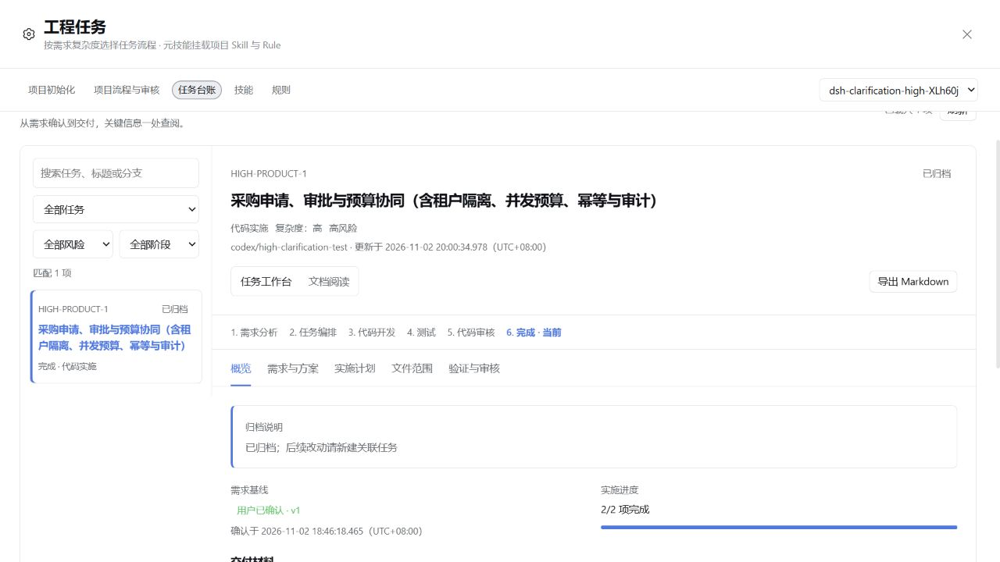

# 高复杂度实测后的流程修复与验证

日期：2026-11-02，Asia/Shanghai。对应[高复杂度与多轮产品确认评测](product-clarification-multiround.md)。

2026-11-03 补充：随后完成了[低、中复杂度真实流程验收](low-medium-live-20261103.md)，并新增 unittest 证据解析、已登记测试命令路由与单次验证超时。下文的 423 项回归和候选哈希记录的是此前检查点；最新结果与边界以补充报告为准。

这次修改针对通用工程插件，不包含 QMS 适配、历史台账迁移或业务代码修改。默认委派与高风险独立审核策略保持原有选择条件；修复的是调用衔接、证据复用和恢复提示。

## 已处理问题

| 实测暴露的问题 | 本次处理 |
| --- | --- |
| direct 实施要求独立审核，但 review_dispatch 隐含要求先 dispatch | 已验证的 direct 交付可直接调用 review_dispatch，由工具登记同一实施身份，再由 accept_item 接受独立结论并标 done。依赖未完成、测试无效、审核代理不可用时仍拒绝启动。 |
| 相同输入重复通过，因回执 id 改变而使验收失效 | 每次执行仍单独保存真实回执；验收引用等价连续成功执行的首条回执，避免纯重跑导致失效。失败、失效标记、输入、测试计划、结果数量、项目根或执行权限边界变化会打断连续性。 |
| 测试阶段仍提示重新审核实施项，提交时点和参数靠猜 | verify 按实际阶段返回下一步，已有有效验收可复用；status 显示检查点、必填字段和已登记提交；commit 返回精确的 record_call，Git 提交与回填保持相同 message/files。 |
| Windows 环境阻塞后尝试改写测试辅助程序、试隔离参数 | verify 提供结构化 environment_blocked 恢复信息，保留原测试与辅助程序，只申请确切命令的一次执行批准；去掉了原诊断中的隔离参数建议。 |
| 审核提示词重复携带完整成功测试日志 | 子代理接收宿主捕获的结构化回执事实及日志长度，完整日志留在台账。仍要求全文读取所有交付文件，仍核验实际读取记录、输出格式、策略证明和内容指纹。 |
| 前端资源冒烟被说成页面验收完成 | 内置代码开发和测试 Skill 明确区分资源/API 冒烟、逻辑断言和实际浏览器行为，并要求说明未覆盖项。没有新增根据测试名称或数量自动推断覆盖率的规则。 |

## direct 与独立审核的明确顺序

```text
plan / plan_execution
    ↓
主会话实现与必要测试
    ↓
verify
    ↓
review=independent → review_dispatch → accept_item
review=main        → accept_item
```

两条 direct 路径均无需额外的实施 dispatch。委派实施仍由 dispatch 启动真实子代理，父会话核对交付并执行真实验证。独立审核失败时，父会话不能用自己的 pass 替换它。

工具 Schema、status/plan/load_skill/verify 返回、主预设提示词及内置 Skill 已统一表达这一路径。直接实施与独立审核是两个不同选择，不再依赖未说明的准备调用。

## 验证复用的边界

下面的第二次成功测试会保存新回执，但保持已有验收有效：

```text
相同计划 + 相同声明输入 + 相同执行边界 + 相同通过结果
pass A → 已审核接受 → pass B → 继续阶段流转
```

下面的情况不能自动恢复旧验收：

```text
pass A → 已审核接受 → fail B → pass C
```

最新失败期间必然阻断；后来即使相同内容又通过，也要重新核对验收，不能直接复活 A 的结论。文件变化、测试计划变化和显式返工失效也保留原有门禁。

这项规则由工具与打包 Git hook 共用的 verification-state 实现，避免台账提示可提交而 hook 拒绝。真实执行时间、输出和每次回执 id 仍保留，未把多次执行合并成一条事实。

## 回归与安装包验证

| 检查 | 结果与范围 |
| --- | --- |
| 旧行为复现 | 新用例在旧构建中复现 direct 审核入口受阻、相同输入重跑导致审核失效；随后在新构建通过。 |
| 最终完整回归 | 423 项：416 通过、0 失败、7 项原有历史宿主测试跳过。 |
| 类型检查、服务端/客户端/hook 构建 | 通过。 |
| rc.5 源码契约 | 严格 codec、40 项 Remote 描述、托管 activation、只读审核预设及五项 peer 范围检查通过。 |
| 真实 rc.5 SDK 宿主 | 从精确候选 tarball 启动隔离预设，需求确认、模板材料、材料变更撤销写权限、只读工具限制等通过；model_calls=0。 |
| 安装包黑盒 | 冷安装、主入口、客户端注册、包内 143 项 P0、资源/流程/真实 hook、CLI 检查通过。 |
| 本地源码页面 | 通过官方源码 CLI 把候选包安装到隔离 web profile，重启 54615；页面可读取归档台账。已逐个比对已安装 JS、提示词、Skill 与 hook 的 SHA-256。 |

新增回归还覆盖：未验证时不创建 direct 实施记录；依赖未接受时不启动审核；父会话无法覆盖独立失败；内容变化后拒绝旧审核；相同输入成功重跑后的工具验收与实际 Git hook 一致；失败后成功不能恢复旧结论；环境恢复不修改测试计划；提交回填使用同一 message/files；审核摘要保留测试事实且完整日志没有丢失。

精确候选 tarball SHA-256：`29e6549a3d61e0c9a27870da831b0ff19c4a97b9068ae45764a027ea53d414c6`。

候选目录从当前 HEAD 建立，只叠加明确的 rc.5 适配与本次流程修复文件。原有两份无关未提交文件的哈希未改变，也没有将其工作区字节覆盖进候选包。

## 尚未证明或尚未修复的部分

1. Windows 沙箱的 EPERM 根因未在插件中修复；本次补的是准确分类和受控恢复路径。实际批准仍由宿主处理，不自动扩大权限。
2. 没有重新调用真实模型跑完整采购需求，也没有可比的性能对照。原案例 74 分钟属于修复前观测，不能宣称本次已经缩短到某个时长或节省某个比例的 token。
3. 资源冒烟、代码静态阅读和行为测试的充分性仍须按需求判断；新增技能要求不能代替真实浏览器验收。
4. 浏览器自动化曾发生的长时间阻塞属于测试工具观测，不包含在本次插件修复内。

当前测试页为 `http://127.0.0.1:54615/`。包内版本仍为 0.39.0，仅为本地候选；GitHub 与 npm 尚未提交或发布本次修改。页面所展示的采购任务是原已归档记录，用于检查重启后工作台读取，不作为新候选已完成真实模型开发的证据。

详细测试日志、候选安装与哈希记录位于被忽略的 `docs/assessment-20261102/source-host/workflow-fix-*`。不提交测试 profile 或凭据。


